# Блок-схемы ЛР2

Оформлены по ГОСТ 19.701-90. Для каждой схемы есть PNG и SVG.

## Рисунок 1 – Общий алгоритм работы сервиса

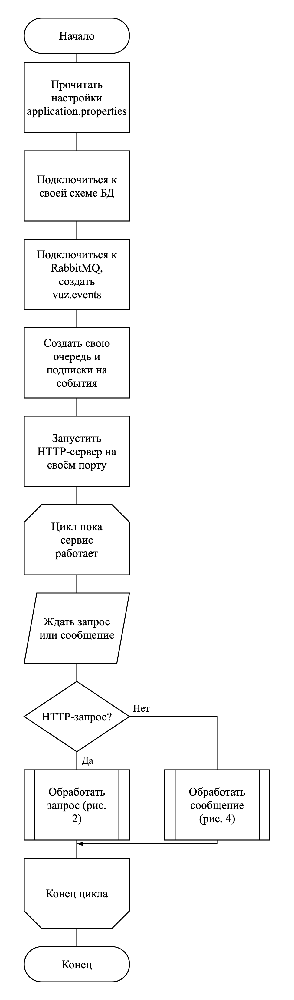

## Рисунок 2 – Обработка HTTP-запроса

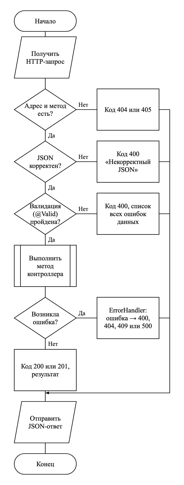

## Рисунок 3 – Отправка события в RabbitMQ (EventPublisher)

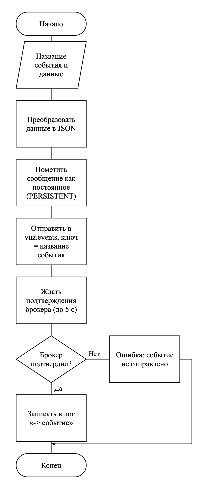

## Рисунок 4 – Приём сообщения из очереди (@RabbitListener)

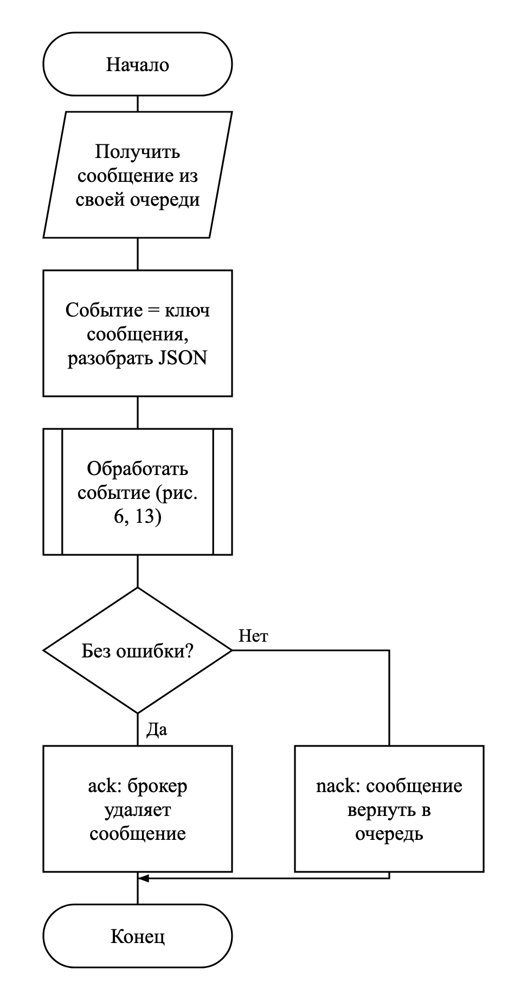

## Рисунок 5 – Добавление персоны (person-service)

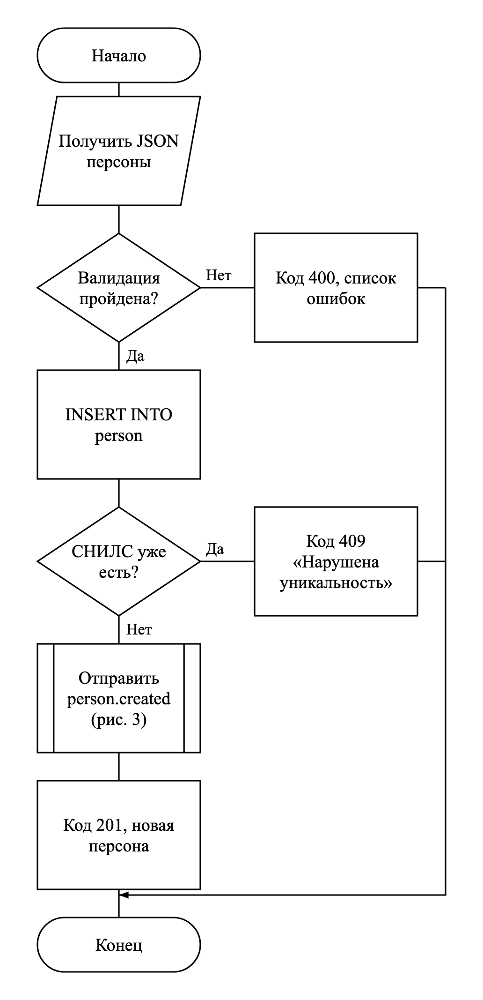

## Рисунок 6 – Удаление персоны (person-service)

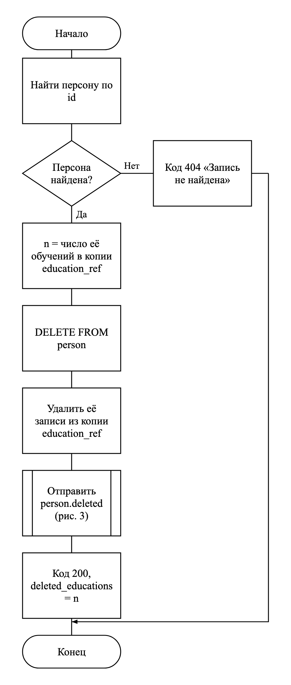

## Рисунок 7 – Обработка событий в education-service (каскады)

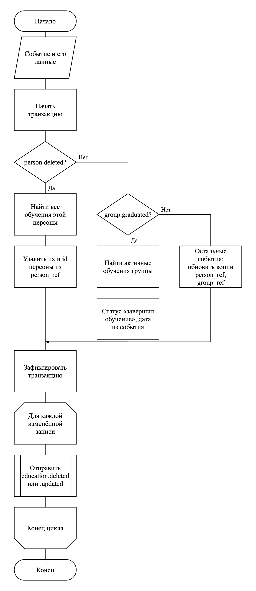

## Рисунок 8 – Добавление записи обучения (education-service)

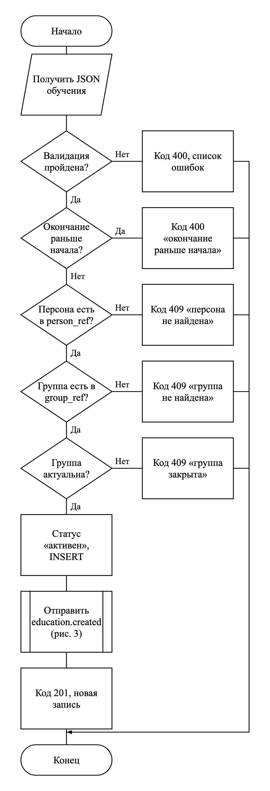

## Рисунок 9 – Изменение записи обучения (education-service)

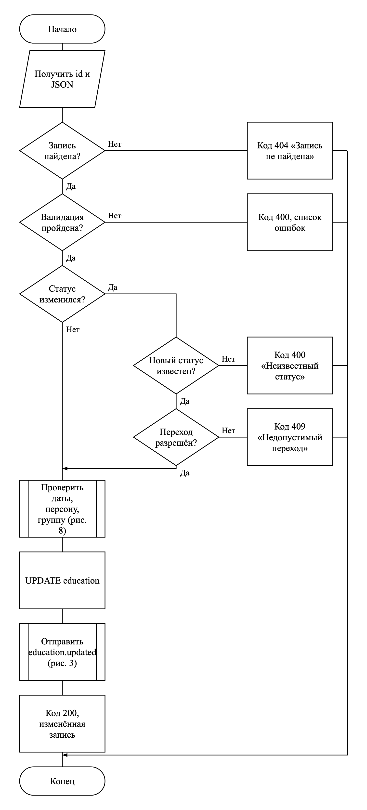

## Рисунок 10 – Добавление группы (group-service)

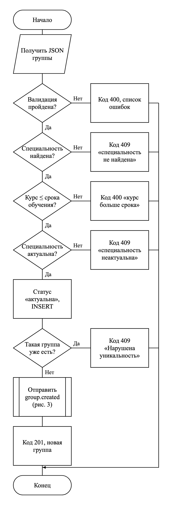

## Рисунок 11 – Удаление группы (group-service)

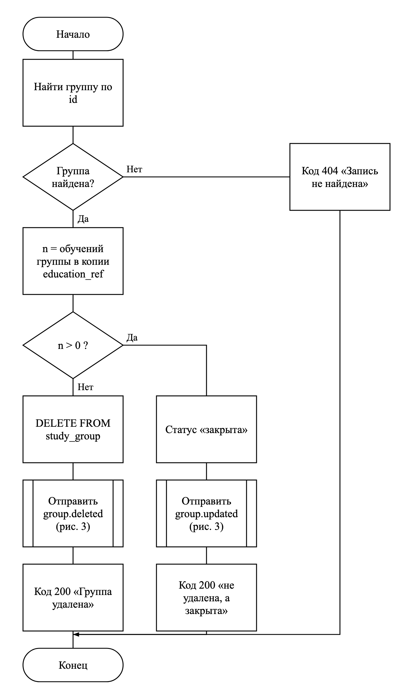

## Рисунок 12 – Удаление специальности (group-service)

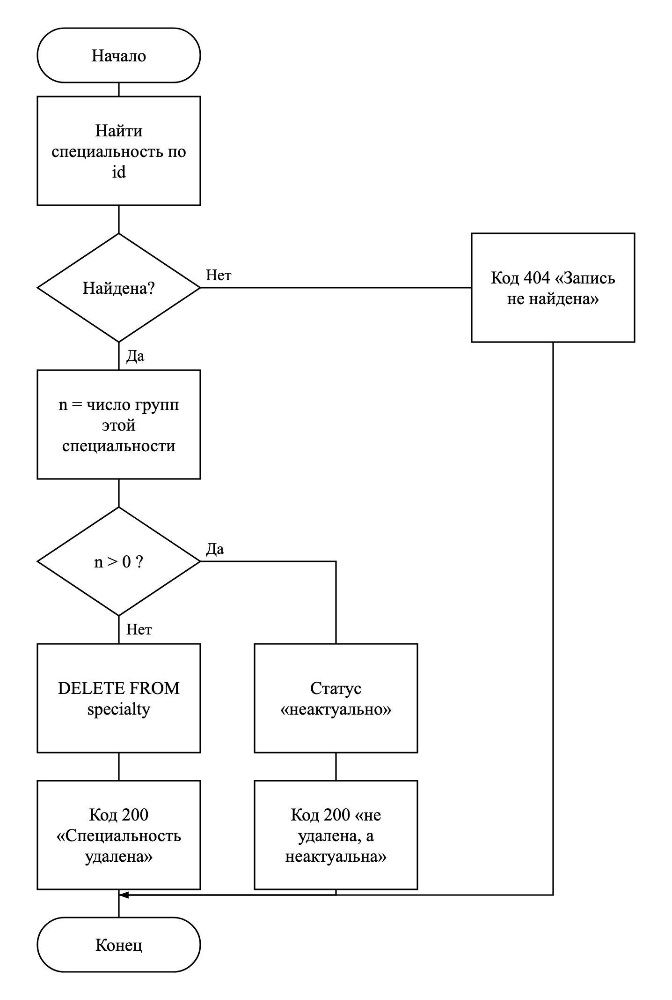

## Рисунок 13 – Событие «Конец учебного года» (group-service)

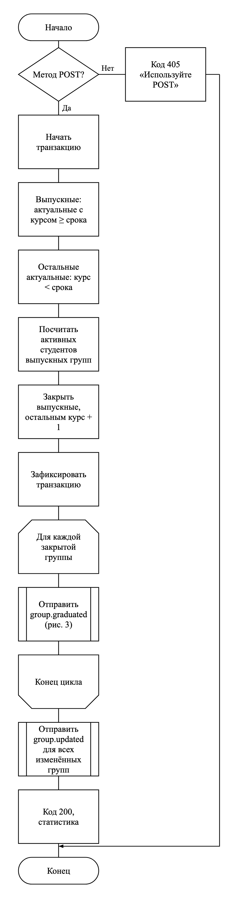

## Рисунок 14 – Обновление копий чужих данных (person-service, group-service)

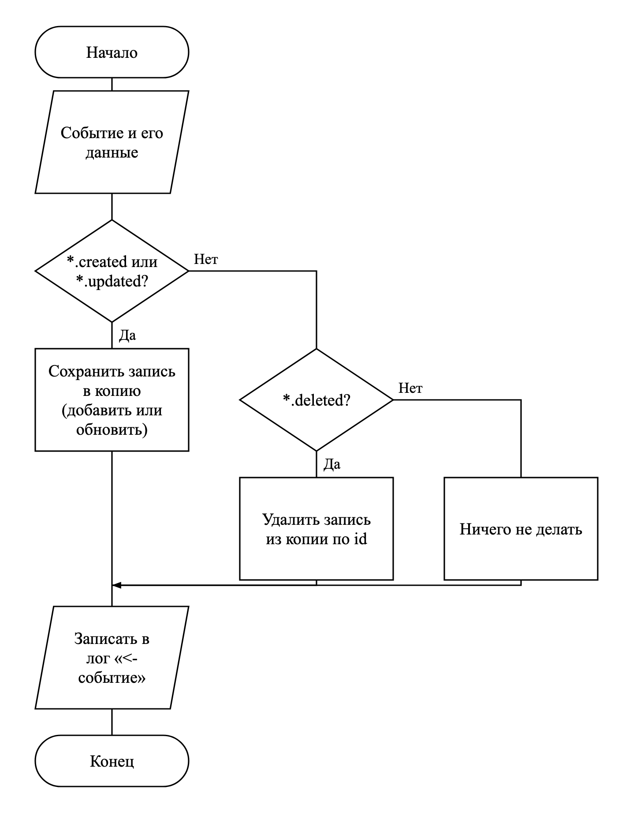

## Рисунок 15 – Список студентов группы или специальности (group-service)

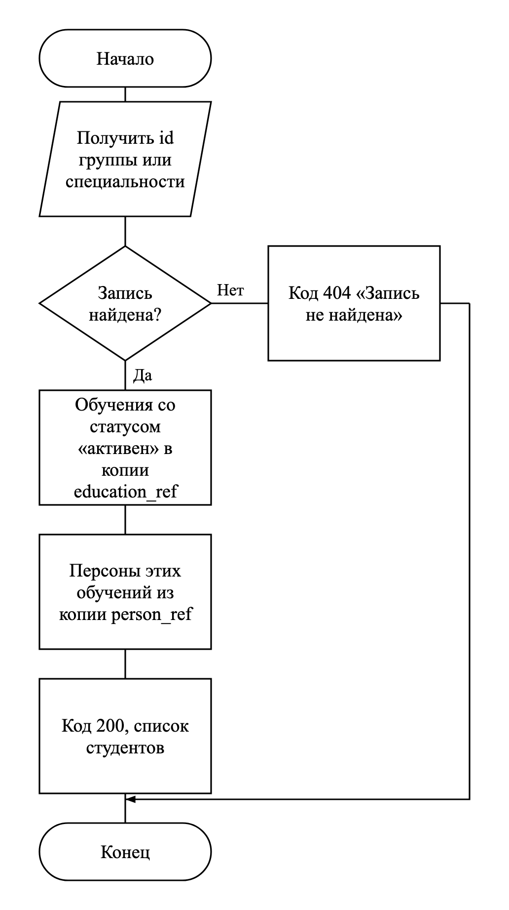

## Рисунок 16 – Поиск отчисленных (person-service)

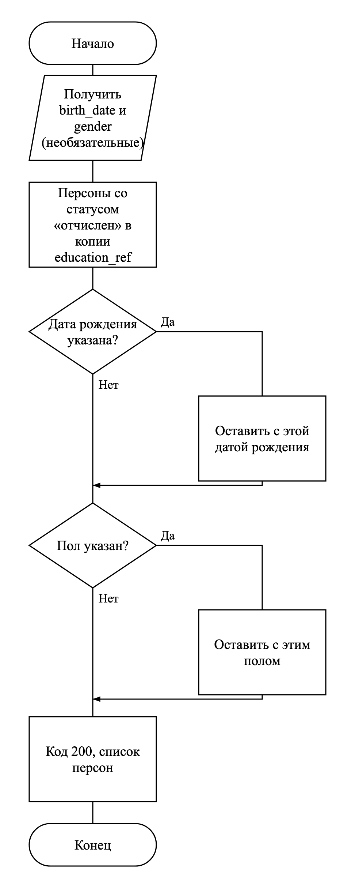

## Рисунок 17 – Информация о студенте: история обучения (person-service)

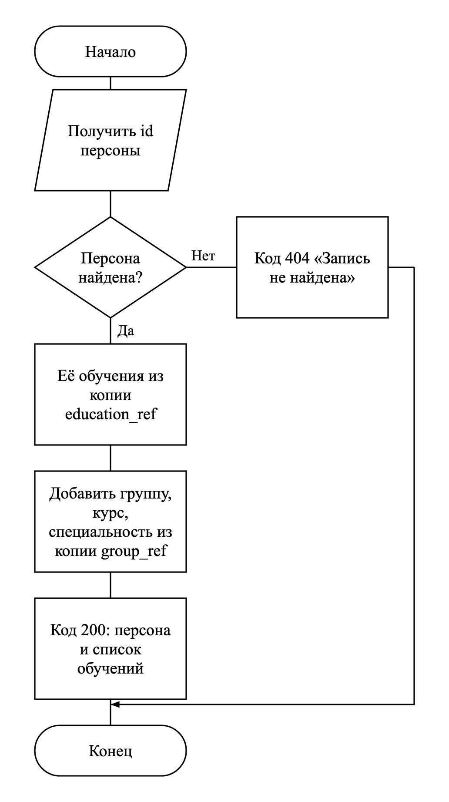

